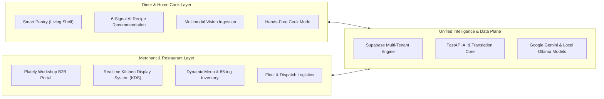
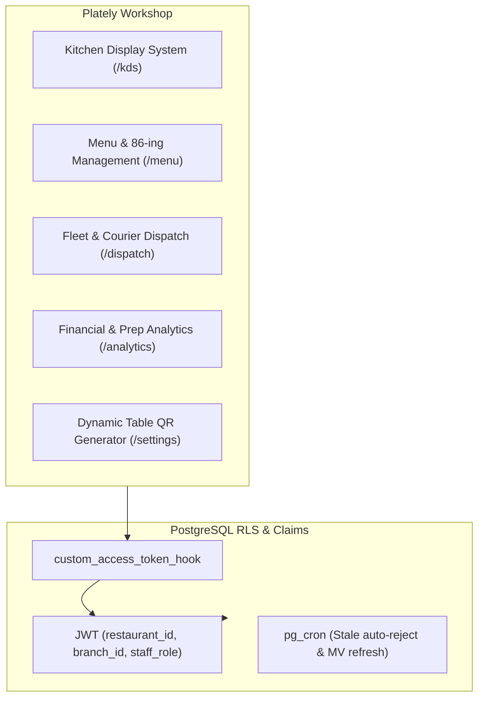
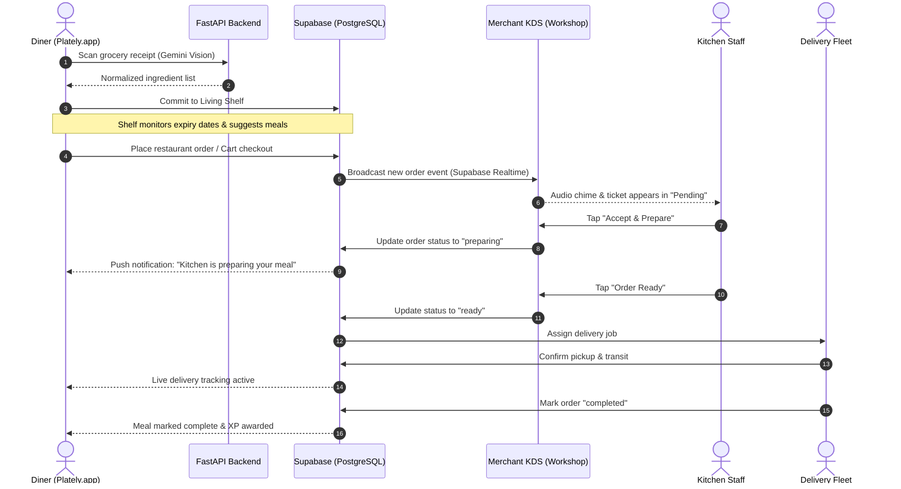
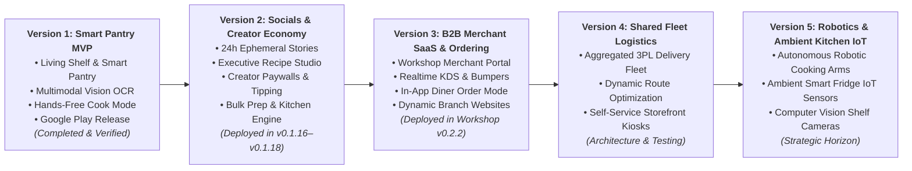

# 🍽️ Plately Ecosystem — Comprehensive Architecture & Technical Blueprint

> **Complete architectural breakdown of the Plately smart kitchen, merchant commerce, and food intelligence platform.**  
> *Last updated: November 2026 | System Version: v0.1.18 / Workshop v0.2.2*

---

## 1. Executive Overview & Value Proposition

**Plately** is a vertically integrated culinary and restaurant operating system designed to bridge consumer kitchen management with B2B restaurant commerce. Originally conceived as an inventory tracker, Plately has evolved into a two-sided network:



### Core Value Drivers:
1. **Zero Food Waste (Diner):** Algorithmic recipe ranking prioritizing ingredients nearing their expiration date.
2. **Frictionless Ingestion (Diner):** Instant conversion of physical receipts, barcode scans, and loose refrigerator photos into structured digital pantries.
3. **High-Margin Operations (Merchant):** Complete bypass of aggregator commission fees through self-managed mobile ordering, direct-table QR codes, and integrated kitchen display operations.
4. **Resilience & Continuity (Ecosystem):** Offline-first architecture across mobile (Hive) and merchant web (Dexie/IndexedDB) guaranteeing uninterrupted service even during network dropouts.

---

## 2. Multi-Repository Topology

The codebase is organized into three specialized repositories residing under the Plately root:

| Repository | Tech Stack | Role & Target Audience | State / Ports |
| :--- | :--- | :--- | :--- |
| [`Plately.app`](./Plately.app) | **Frontend:** Flutter 3, Riverpod, Hive<br/>**Backend:** FastAPI, Python 3.10+, Gemini 2.5/Ollama | Consumer mobile app (iOS / Android), AI microservice layer, and Dual-Mode Cook & Order OS. | Port `8000` (API)<br/>Mobile Bundle `0.1.18+17` |
| [`Plately.workshop`](./Plately.workshop) | Next.js 16 (Turbopack, App Router), React 19, TypeScript, Tailwind CSS v4, Zustand | Merchant B2B operating system: Multi-tenant custom domains, Realtime KDS with keyboard bumper controls, AI website studio with undo/redo, dispatch, and analytics. | Port `3000` (Web / Docker Standalone) |
| [`Plately.web`](./Plately.web) | React 19, Vite, Tailwind CSS, Framer Motion | Brand marketing, interactive dual-platform showroom, investor demos, and customer onboarding. | Port `5173` (Vite) / Live at [theplately.com](https://theplately.com) |

---

## 3. Subsystem Breakdown

### 3.1 Plately.app (Consumer Mobile Client)

Built on Flutter using **Clean Architecture** principles (Presentation, Domain, and Data layers) separated into modular feature domains:

```mermaid
flowchart TD
    AppShell["lib/main.dart (Dual-Mode AppShell)"]
    AppShell --> DualMode["DualModeNavBar & ModeSwitch"]
    
    subgraph CookMode["🧑‍🍳 Cook Mode (Home Kitchen)"]
        DualMode --> Shelf["features/shelf (Living Shelf)"]
        DualMode --> Scan["features/scan (Multi-Scan Suite)"]
        DualMode --> Cook["features/cook (6-Tier Engine)"]
        DualMode --> Explore["features/social (Feeds & Explore)"]
        DualMode --> Profile["features/profile (Profile & Kitchen Data)"]
        
        Cook --> RecipeTiers["6 Tabs: Explore | Perfect | For You | Use It Up | Almost | 💎 Executive"]
        Cook --> VoiceAssist["Hands-Free Voice Assistant (Watchdog & Text Fallback)"]
        Cook --> MiniPlayer["CookingMiniPlayer & Interactive Timers"]
        Cook --> BulkHub["Bulk Cooking & Meal Prep Hub"]
        
        Shelf --> KitchenEngine["Multi-Zone Kitchen Storage Engine"]
        Shelf --> Freshness["Visual Freshness Degradation & Auto-Depletion"]
        
        Scan --> ScanSuite["Receipt OCR, Loose Vision, Barcode & Calorie Plate"]
        
        Explore --> SocialHub["Feeds & Socials Hub (Community & 24h Stories)"]
        Explore --> ExecStudio["Executive Recipe Studio & Monetization"]
    end

    subgraph OrderMode["🛍️ Order Mode (Diner Commerce)"]
        DualMode --> OrderScreen["features/order (Merchant Menus & 86-ing)"]
        OrderScreen --> BranchSites["Workshop Dynamic Website Links"]
        OrderScreen --> TableBookings["In-App Table Reservations"]
        OrderScreen --> CartCheckout["Cart & Live Pickup Tracking"]
    end
```



#### Key Modules:
* **Dual-Mode OS Navigation (`core/widgets`):**
  * Effortless switching between **Cook Mode** (home pantry inventory, AI meal recommendations, smart timers) and **Order Mode** (restaurant ordering, branch menus, table reservations) via `DualModeNavBar` and header `ModeSwitch`.
  * `RegionPickerSheet` allows diners to select regional culinary hubs and discover active merchant branches.
* **The Living Shelf & Kitchen Data Engine (`features/shelf`, `features/cook`):**
  * Categorizes inventory into Produce, Meat, Seafood, Dairy, Pantry, Frozen, and Bakery with visual expiration degradation.
  * **Kitchen Data Hub (`kitchen_data_hub_screen.dart`):** Organizes inventory across 5 physical storage zones (Freezer, Fridge, Cold Pantry, Dry Cabinet, Spice Rack) with simulated environmental tracking, capacity utilization metrics, and food waste diversion analytics.
  * Auto-depletes ingredients from local Hive/SharedPreferences cache and remote Supabase tables once a meal is marked complete in Cook Mode.
* **Scan Suite (`features/scan`):**
  * **Receipt Parser:** Scans printed grocery receipts via Gemini Vision OCR, parsing item lines, quantity, origin, and tax exemptions.
  * **Loose Ingredient Scanner:** Direct visual segmentation of items laid out on a kitchen counter.
  * **Barcode Scanner:** Real-time UPC lookup with fallback to Open Food Facts API.
  * **Visual Calorie Plate Scanner:** Estimates portion sizes, plate weight (grams), calories, and macronutrient decomposition directly from restaurant dish photos.
  * **Audit Review Flow:** Intermediate validation interface allowing users to review, correct, or discard AI classifications prior to committing to the pantry.
* **Cook Mode & 5-Layer Resilient Recipe Engine (`features/cook`):**
  * **6 Comprehensive Tabs:** `[Explore | Perfect | For You | Use It Up | Almost | 💎 Executive]`.
  * **5-Layer Resilient Retrieval Pipeline:** Server-Side AI Scoring (`/api/v1/recipes/recommend`) ➔ Supabase RPC `get_recommended_recipes` ➔ Direct table query with client-side sorting ➔ Local `CacheService` offline storage ➔ Curated offline fallback recipes.
  * **Auth Resilience:** Safe guest UUID fallback in `AuthHelper` guaranteeing seamless recipe access for unauthenticated users.
  * **Hands-Free Cooking Guidance:** Step-by-step swipeable UI with contextual action badges (🔥 heat, ✂️ slice, 🍳 sauté) and embedded concurrent timers linked to a background mini-player.
* **Hands-Free Voice Command Assistant (`VoiceCommandFAB` & `VoiceCommandService`):**
  * Speech recognition with 8-second auto-silence detection and 10-second safety watchdog timer preventing button hangs.
  * Interactive text input fallback dialog when audio hardware or permissions are unavailable.
  * Real-time animated speech activity HUD.
* **Bulk Cooking & Meal Prep Hub (`features/cook`):**
  * Scalable batch recipe generator (2 to 14+ servings) with dynamic prep timelines.
  * Container defrost timeline and food safety temperature guidance.
  * Auto-export batch meals directly into Living Shelf leftover inventory.
* **Socials Hub, 24-Hour Stories & Creator Monetization (`features/social`, `features/cook`):**
  * **Feeds & Stories:** 24-hour ephemeral stories (`StoryRing`, `StoryViewer`) with recipe tagging and community posts.
  * **Executive Recipe Studio (`ExecutiveRecipeStudioScreen`):** Creator publishing workstation supporting Free, Premium, and Executive tiers, custom paywalls, and author royalties.
  * **Conversion Sheets:** `RecipePaywallSheet`, `ShoppableIngredientsSheet`, and `TipChefSheet`.
* **Order Mode & Merchant Dining (`features/order`):**
  * Real-time digital menu browsing respecting merchant **86-ing synchronization** (sold-out badges).
  * Direct links to Workshop merchant branch dynamic showcase websites and in-app table bookings.
  * Live WebSocket order tracking (`OrderHistoryScreen`) via Supabase Realtime with milestone updates (`pending` ➔ `preparing` ➔ `ready` ➔ `dispatched` ➔ `completed`).
* **Health & Gamification (`features/profile`, `features/gamification`):**
  * **Flavor Radar:** 6-axis spider chart plotting Sweet, Salty, Sour, Bitter, Umami, and Spicy preferences.
  * **Gamification Engine:** Grants XP drops, awards achievement badges, and tracks cooking streaks.
* **Storage & Android Compliance:**
  * Stripped legacy media storage permissions (`READ_EXTERNAL_STORAGE`, `READ_MEDIA_IMAGES`) using `tools:node="remove"`, integrating natively with the Android 14+ Photo Picker.
  * Multi-tier `CacheService` with Hive, SharedPreferences fallback, and Safari private browsing quota handling.

---

### 3.2 Plately.app Backend (AI & Intelligence Core)

FastAPI microservice hosting specialized endpoints and AI orchestrators:

* **Endpoint Routing:**
  * `/api/v1/recipes/recommend`: 6-signal algorithmic scoring running against pantry items.
  * `/api/v1/vision/ocr-receipt`: Multimodal OCR prompt pipeline with zero-hallucination constraints.
  * `/api/v1/vision/detect-ingredients`: Vision-based ingredient classification.
  * `/api/v1/vision/estimate-calories`: Visual portion estimation and macronutrient decomposition.
  * `/api/v1/meal-prep/generate`: Batch cooking generator outputting multi-day meal plans (8,192 token window with resilient JSON repair fallback).
  * `/api/v1/translations`: On-the-fly taxonomy and recipe translation supporting English, Korean, Uzbek (Latin & Cyrillic), and Russian.
* **Security & Reliability:**
  * PostgREST injection protection via query sanitization before `.ilike()` execution.
  * Strict cryptographic token generation using Python `secrets.choice()`.
  * Middleware enforcing HTTP Strict Transport Security (HSTS), nosniff, and anti-clickjacking headers.

---

### 3.3 Plately.workshop (B2B Merchant Portal)

A high-performance Next.js 16 web application enabling restaurants and food merchants to manage incoming traffic, kitchen preparation, and delivery logistics.



#### Core Capabilities:
* **Multi-Tenant Branded Subdomains & Custom Domains:**
  * Next.js Edge proxy (`src/proxy.ts`) with in-memory TTL caching resolving tenant slugs (<5ms).
  * Automated DNS verification API (`/api/domains/verify`) with live CNAME and challenge TXT record checks.
  * In-app DNS management in Workshop Settings with 1-click clipboard guidance.
  * Multi-stage standalone Dockerfile with non-root security and `/api/health` probes.
* **AI Website Studio & Interactive Floor Plan:**
  * Multimodal Gemini command bar supporting voice recording, image menu uploads, and model selection.
  * Multi-step **Undo/Redo history stack** with global keyboard shortcuts (`Ctrl+Z` / `Ctrl+Y`).
  * Dynamic Island smartphone preview frame with responsive mobile CSS isolation.
  * Supabase storage image transformations with automatic CDN resizing and lazy loading.
  * Interactive floor plan table designer with zone management (Window Booths, Main Dining, VIP Terrace).
  * Public storefronts at `/store/[slug]` with Schema.org SEO rich snippets and live table reservation persistence.
* **Realtime Kitchen Display System (KDS):**
  * Displays live tickets organized by state: `pending`, `preparing`, `ready`, `dispatched`, `completed`, and `rejected`.
  * **Gloves-Friendly Keyboard Bumper Controls:** Operators can bump tickets using `Space`, toggle fullscreen with `F`, and toggle sound alerts with `M`.
  * Auditory bump chimes and persistent zero-asset Web Audio synthesis alerts on incoming orders powered by Supabase Realtime WebSocket listeners.
  * Desktop notifications via the Web Notification API for kitchen alerts when the tab is backgrounded.
* **Financial & Prep Analytics Dashboard:**
  * Interactive 7-day, 30-day, and 90-day sales and order volume trend visualizations.
  * **Empirical Demand Forecasting:** Predictive hourly prep load model based on historical order volume.
  * Parallelized dashboard query execution and rich CSV exports for bookkeeping and reconciliation.
* **Menu Engineering & Modifier Matrix:**
  * Multi-tier modifier groups (e.g., single-select sizes, multi-select toppings, required spice levels).
  * Instant "86-ing" toggle that immediately syncs across consumer apps to mark items as "Sold Out" and disable diner ordering.
* **Fleet & Driver Dispatch:**
  * Coordinates in-house or contracted delivery fleets (Noor 3PL) with HMAC-SHA256 signature verification, idempotency tracking, and automatic order milestone synchronization.
* **Multi-Tenant Security & Performance Architecture:**
  * **Custom Auth Access Token Hook (`custom_access_token_hook`):** Injects `restaurant_id`, `branch_id`, and `staff_role` directly into the Supabase JWT `app_metadata`.
  * **Row-Level Security (RLS):** Every database query strictly isolates tenant data by querying `auth.restaurant_id()`.
  * **High-Throughput Database Indexes (Migration 014):** Optimized composite indexes on `orders (restaurant_id, status, created_at)` guaranteeing sub-10ms ticket querying during peak kitchen rushes.
  * **Automated Cron Jobs (`pg_cron`):**
    * Auto-rejects unaccepted orders after expiration thresholds.
    * Refreshes the `mv_merchant_analytics` materialized view every 5 minutes.
    * Prunes stale webhook payloads older than 30 days.

---

### 3.4 Plately.web (Public Marketing & Showcase)

Vite + React single-page application built with modern dark glassmorphic styling:
* **Interactive Live Demos:** Provides prospective diners, merchants, and investors with realistic simulations of Cook Mode, Scan Mode, and the KDS.
* **Conversion Funnels:** Early-access waitlist collection and merchant onboarding inquiries.
* **Asset Optimization:** Standalone bundling with zero external runtime dependencies.

---

## 4. End-to-End Data & Order Lifecycle



---

## 5. Security, Multi-Tenancy & Compliance Matrix

| Surface | Protection Mechanism | Implementation Detail |
| :--- | :--- | :--- |
| **Merchant Data Isolation** | PostgreSQL Row-Level Security (RLS) | Enforced via `auth.restaurant_id()` extracted from custom JWT claims hook. |
| **Role-Based Access Control** | Hierarchical Role Checks | `owner` > `admin` > `manager` > `chef` / `waiter` / `courier` validated via `auth.has_min_role()`. |
| **AI Prompt Injection & Hallucination** | Schema Validation & Anti-Hallucination Guardrails | Pydantic response models, temperature tuning (0.1 for OCR), empty-state fallbacks. |
| **Database Query Security** | SQL Injection Sanitization | User search strings sanitized through `sanitize_search_query()` before `.ilike()`. |
| **Mobile Storage Compliance** | Android 14+ Photo Picker | Explicit stripping of `READ_EXTERNAL_STORAGE` and `READ_MEDIA_IMAGES` in `AndroidManifest.xml`. |
| **Network & Transport** | Security Header Middleware | Strict-Transport-Security (`max-age=31536000`), `X-Frame-Options: DENY`, `nosniff`. |

---

## 6. Strategic Evolution Roadmap



* **Version 1 (Completed & Verified):** Full consumer mobile pantry, offline-first execution, AI scanning suite, and 62/62 verified backend regression tests.
* **Version 2 (Deployed in v0.1.16–v0.1.18):** Unified Feeds & Socials hub, 24-hour ephemeral stories, Executive Recipe Studio with creator monetization (paywalls, tip chef, shoppable ingredients), Bulk Cooking & Meal Prep Hub, and Kitchen Data & Storage Engine.
* **Version 3 (Deployed in Workshop v0.2.2 & Mobile Order Mode):** Commercial restaurant operating system, multi-tenant custom domains, realtime KDS with keyboard bumper controls, in-app diner Order Mode with 86-ing synchronization, and table reservations.
* **Version 4 (Next Phase - In Progress):** Turnkey self-ordering kiosk terminals and automated 3PL dispatch routing (Noor logistics).
* **Version 5 (Long-Term Vision):** Robotic cooking automation, connected ambient smart fridge hardware sensors, and camera-based real-time inventory tracking.

---

## 7. Developer & Operations Quick-Reference

### Starting Services Locally
* **Backend API:**
  ```powershell
  cd Plately.app/backend
  venv\Scripts\activate
  uvicorn app.main:app --reload --port 8000
  ```
* **Frontend Mobile App:**
  ```powershell
  cd Plately.app/frontend
  flutter run
  ```
* **B2B Workshop Portal:**
  ```powershell
  cd Plately.workshop
  npm run dev
  ```
* **Marketing Web:**
  ```powershell
  cd Plately.web
  npm run dev
  ```

### Verification & Automated Testing
* **Backend Pytest Suite:** `python -m pytest tests/` in `Plately.app/backend` (62/62 passing).
* **Mobile Static Analysis:** `flutter analyze --no-fatal-infos` in `Plately.app/frontend` (0 errors).
* **Workshop Typecheck & Build:** `npx tsc --noEmit && npm run build` in `Plately.workshop` (Clean production output).
* **Web Landing Build:** `npm run build` in `Plately.web` (Vite production build clean).
